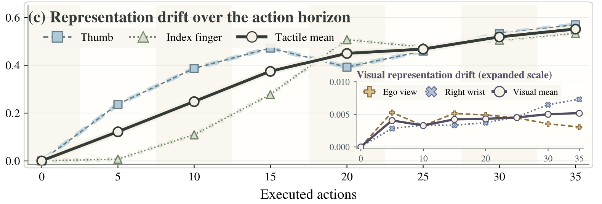
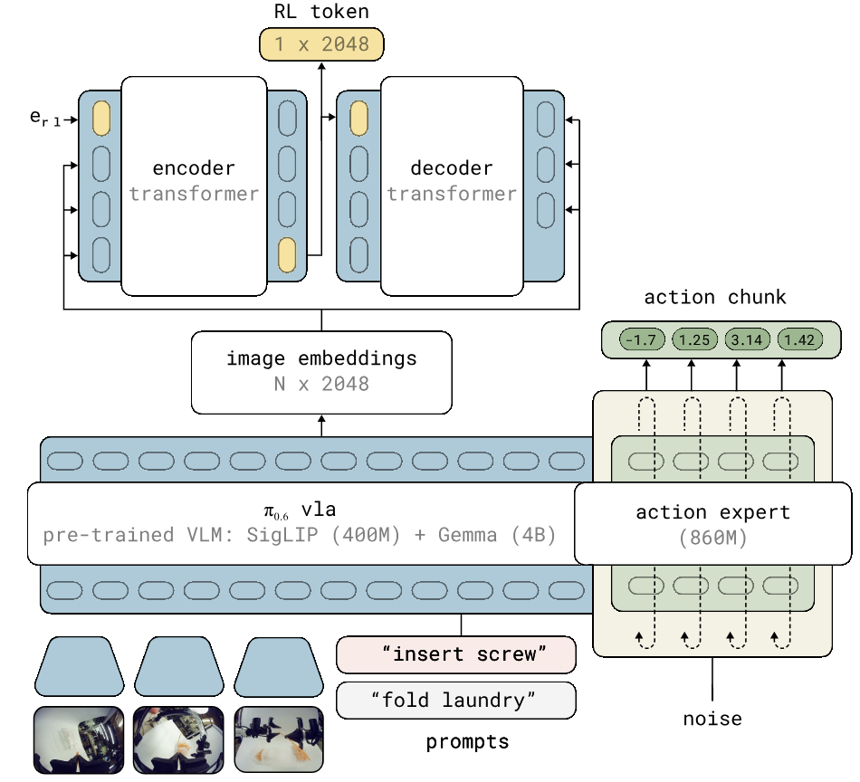
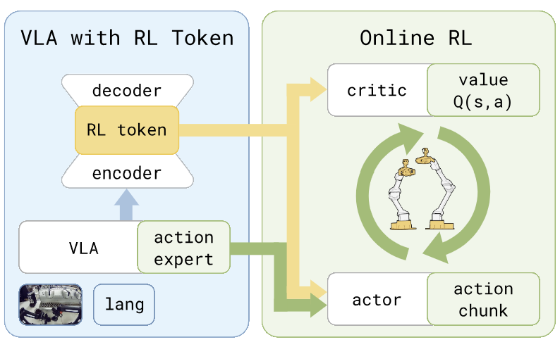
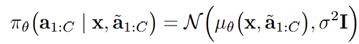

# Tactile RL Token for Dexterous Manipulation

# 1. Problem

**(1) action chunk 내에서 빠르게 변화하는 tactile representation에 반응하기가 어렵다.** 

Contact-rich manipulation에서 visual observation과는 다르게 tactile representation은 single action chunk 내에서 빠르게 변한다. 

따라서, action chunk 내에서 tactile input에 reactive하게 반응할 필요성이 있다. 

references: Tacforcing(2026), Reactive Diffusion Policy(2025), FIRe(2026)

> **피드백:** 문제 정의가 명확함. 핵심은 tactile의 변화 자체보다 “변화한 접촉 상태에 맞춰 남은 action을 수정해야 한다”는 점임. 그래프는 해당 사례의 동기로 활용하되, 모든 task에서 tactile이 더 빠르게 변한다거나 특정 actor step이 최적이라는 근거로 일반화하지 않으면 좋겠음.

**(2) 기존 VLA는 tactile modality를 input으로 하지 않아 tactile input에 adapt하기 어렵다.** 

pi0, gr00t와 같은 existing pretrained VLA에 tactile input을 추가하여 post-training하는 연구들이 등장하고는 했지만, 이는  policy의 pretrained dataset에 없던 정보이기 때문에 기존 pretrained knowledge를 해칠 우려가 있으며 training cost 또한 비싸다. 

물론, 최근 tactile pretraining dataset을 구축하고 tactile-enhanced VLA가 등장하고 있으나, 여전히 large-scale tactile pretraining dataset을 모으기가 어렵고 마찬가지로 training cost가 비싸다. 

따라서, 기존 VLA의 pretrained knowledge를 유지하면서도, lightweight RL actor module을 통해서 tactile input에 adapt하고 contract-rich task를 해결하고자 한다. 

references: Tactile-VLA, OmniVTLA, FTP-1, T-Rex

> **피드백:** Tactile SFT가 pretrained knowledge를 해친다는 것은 가능성이지 필연은 아님. VLA freeze도 가중치 보존을 의미하며 최종 actor의 일반화 성능까지 보장하지는 않음. “학습 범위를 작은 모듈로 제한한다”는 장점을 강조하고, 전체 비용은 GPU 비용과 로봇 interaction 비용을 함께 확인하면 좋겠음.

## 1.1. Expected Contribution

(1) introduce Tactile + RL token framework

(2) introduce base policy + tactile-reactive RL actor 

(3) Contact-rich dexterous manipulation task에서 baseline보다 좋은 성능 보임

> **피드백:** Slow–fast 구조와 접촉 기반 보정 자체는 선행 연구가 있으므로, ① 최신 tactile을 활용한 online RL의 효과, ② 단순 concat 대비 joint token의 추가 가치, ③ 다지 손의 접촉·재파지 제어에서의 효과를 각각 검증할 기여로 구체화하면 좋겠음.

# 2. Related Works

**(1) RDP** 

https://arxiv.org/abs/2503.02881

**(2) FIRe**

https://rcilab.khu.ac.kr/FIRe/

residual RL 

Wrist 부분의 Force 정보만 사용 

dexterous 아님 

RL token-based 아님 

**(3) ViTaR**

https://arxiv.org/abs/2608.15816

base VLA + tactile residual module이긴 함 

근데 RL 아니고 guidance mechanism 기반임 

dexterous 아님 

**(4) VT-Bridge**

https://arxiv.org/abs/2609.22606

base VLA + tactile residual module이긴 함 

근데 RL 아니고 Residual Module SFT임. 

dexterous 아님 

**(5) RL Token** 

Tactile 사용 안 함 

> **피드백:** RDP는 slow–fast tactile feedback의 선행 연구라는 점을 보충하고, 실행 중 tactile을 반영하는 TacForcing도 관련 연구에 추가할 가치가 있음. “dexterous 아님”은 “다지 손의 독립적인 접촉·재파지 제어를 다루지 않음”처럼 구체화하면 차이가 더 명확해짐.

# 3. Preliminaries

## 3.1. Residual RL

base policy: VLA (frozen or 살짝 SFT) 

residual policy: RL actor (RL training)

$$
{\rm{base~policy:~}}~a_{t:t+H}~{{\sim}}~{\pi}_{\theta}(a_{t:t+H}|o_{t},l,s_{t}) \\ {\rm{residual~policy:~}}{\triangle}a_{t:t+H}~{\sim}~{\pi}_{RL}({\triangle}a_{t:t+H}|o_{t},l,s_{t}) \\ {\rm{executed~ action}}:a_{t:t+H}+{\triangle}a_{t:t+H}

$$

## 3.2. RL Token

https://arxiv.org/abs/2604.23073

Final Output

- RLT Algorithm
    
    $$
    \begin{aligned}
    &\textbf{Algorithm 1}\quad \textbf{RLT}\\
    &\textbf{Require:}\ \text{Frozen VLA backbone }f_{\theta_{\mathrm{vla}}}
    \text{ and VLA action distribution }\pi_{\mathrm{vla}};\\
    &\qquad \text{demo data }\mathcal D,\ \text{chunk length }C,\ 
    \text{replay buffer }\mathcal B,\ \text{warmup steps }N_{\mathrm{warm}},\\
    &\qquad \text{ratio }G,\ \text{VLA fine-tuning weight }\alpha,\ 
    \text{policy constraint }\beta.\\[6pt]
    &1:\ \textbf{Train RL token and (optionally) fine-tune the VLA}\\
    &2:\ \text{Train }\phi\text{ using }
    \bar{\mathbf z}_i=f_i(s,\ell,\theta_{\mathrm{vla}}),\quad
    \mathbf z_{\mathrm{rl}}
    =g_\phi([\mathbf z_{1:M},\mathbf e_{\mathrm{rl}}])_{M+1},\\
    &\qquad \text{and }\theta_{\mathrm{vla}}\text{ (only if }\alpha>0\text{).}\\[4pt]
    &\qquad
    \mathcal L_{\mathrm{ro}}(\phi)
    =\mathbb E_{\mathcal D}\left[
    \sum_{i=1}^{M}
    \left\|
    h_\phi\!\left(
    d_\phi([\mathbf z_{\mathrm{rl}},\bar{\mathbf z}_{1:i-1}])
    \right)_i-\bar{\mathbf z}_i
    \right\|^2
    \right].\\[6pt]
    &3:\quad
    \phi,\theta_{\mathrm{vla}}
    =\underset{\phi,\theta_{\mathrm{vla}}}{\arg\min}\,
    \mathcal L_{\mathrm{ro}}(\phi)
    +\alpha\mathcal L_{\mathrm{vla}}(\theta_{\mathrm{vla}})\\[6pt]
    &4:\ \textbf{Train RL actor and critic}\\
    &5:\ \text{Initialize critic }Q_\psi
    \text{ and RL Policy }\pi_\theta.\\
    &6:\ \textbf{for }\text{environment steps }t=0,C,2C,\ldots
    \quad\textbf{do}\\
    &7:\qquad \text{Sample VLA reference chunk }
    \tilde{\mathbf a}_{t:t+C-1}\sim\pi_{\mathrm{vla}}(\mathbf s_t).\\
    &8:\qquad \text{Form RL state }
    \mathbf x_t=(\mathbf z_{\mathrm{rl}}(\mathbf s_t),\mathbf s_t^p).\\[4pt]
    &9:\qquad
    \mathbf a_{t:t+C-1}\leftarrow
    \begin{cases}
    \mathbf a^{\mathrm{human}} & \text{if intervention}\\
    \tilde{\mathbf a}_{t:t+C-1} & \text{if }t<N_{\mathrm{warm}}\\
    \sim\pi_\theta(\,\cdot\mid\mathbf x_t,\tilde{\mathbf a})
    & \text{otherwise}
    \end{cases}\\[6pt]
    &10:\qquad \text{Execute }\mathbf a_{t:t+C-1}
    \text{ and observe }r_t,\mathbf s_{t+1},\mathbf s_{t+1}^p.\\
    &11:\qquad
    \tilde{\mathbf a}_{t:t+C-1}\leftarrow\mathbf a^{\mathrm{human}}
    \quad\text{if intervention}\\
    &12:\qquad \text{Store transition in }\mathcal B:\quad
    \langle\mathbf x_t,\mathbf a_{t:t+C-1},
    \tilde{\mathbf a},r_t,\mathbf x_{t+1}\rangle\\
    &13:\qquad \textbf{for }g=1,\ldots,G\quad\textbf{do}\\
    &14:\qquad\qquad \text{Sample batch of data }\mathrm b\sim\mathcal B.\\
    &15:\qquad\qquad \text{Compute target Q values}\\[4pt]
    &\qquad\qquad
    \hat Q=\sum_{t'=1}^{C}\gamma^{t'-1}r_{t'}
    +\gamma^C\mathbb E_{\mathbf a'\sim\pi_\theta}
    \left[Q_{\psi'}(\mathbf x',\mathbf a')\right]\\[6pt]
    &16:\qquad\qquad \text{Train Critic with TD backup (Eq. (3))}\\[4pt]
    &\qquad\qquad
    \mathcal L_Q(\psi)=\mathbb E_{\mathrm b}
    \left[\left(\hat Q-Q_\psi(\mathbf x,\mathbf a)\right)^2\right]\\[6pt]
    &17:\qquad\qquad \text{Train Policy }
    \mathbf a\sim\pi_\theta(\,\cdot\mid\mathbf s,\tilde{\mathbf a})
    \quad\text{(Eq. (5))}\\[4pt]
    &\qquad\qquad
    \mathcal L_\pi(\theta)=\mathbb E_{\mathrm b}
    \left[-Q_\psi(\mathbf x,\mathbf a)
    +\beta\|\mathbf a-\tilde{\mathbf a}\|_2^2\right]\\[6pt]
    &18:\qquad \textbf{end for}\\
    &19:\ \textbf{end for}
    \end{aligned}
    $$
    

Goal of RLT: leverage the VLA’s generalization while achieving the speed and sample efficiency of lightweight online RL

물론, RLT 아키텍처는 residual RL policy는 아니고 Gaussian RL policy임. 

> **피드백:** Residual은 보정량/최종 action 중 무엇을 출력하는지, Gaussian은 출력 분포를 어떻게 정의하는지에 관한 서로 다른 구분임. RLT는 “reference action을 조건으로 최종 action을 직접 출력하고, reference에 가깝도록 regularization하는 정책”으로 설명하면 정확함. 조원 설명용 본문에서는 긴 알고리즘을 부록으로 옮겨도 좋겠음.

# 4. Method

base policy: frozen or slightly fine-tuned VLA 

RL policy: RL Token augmented with Tactile Representation 

base policy가 H horizon의 action chunk를 생성 ( ex) H = 50) 

actor는 base policy가 생성한 chunk를 입력으로 받고 H’ (H’ < H)  horizon의 action chunk를 생성

이를 통해 actor가 빠르게 tactile represenation에 반응.  

> **피드백:** 짧은 chunk만으로 반응성이 보장되지는 않음. 매 actor 호출에 최신 tactile·proprioception을 넣고, encoding·fusion·inference가 목표 주기 안에 끝나야 함. Base chunk를 재사용할 때는 현재 실행 위치에 맞는 reference 구간 또는 offset을 제공하고, arm/hand 중 actor가 수정할 action 범위도 명시하면 좋겠음.

Design choices

**(1) Tactile Representation을 어디에 통합할 것인가.** 

RL Token을 만드는 encoder에 통합, encoder에서 RL  token이 나온 후에 별도 모듈로 RL token에 통합, RL token과 Tactile Representation을 단순히 concat해서 actor에 전달 등등등 

> **피드백:** 결합 위치와 함께 tactile encoder·fusion module의 학습 loss 및 online RL 중 freeze/update 범위도 설계 항목으로 추가하면 좋겠음. VLM embedding만 복원하는 loss로는 tactile 정보 보존이 충분히 유도되지 않을 수 있음. Critic에도 최신 접촉 정보를 제공할지 명시하고, 단순 concat을 첫 구현과 비교 기준으로 두면 유용함.

**(2) Actor(RL policy)와 base policy의 frequency** 

RL token에서는 base VLA의 chunk horizon은 50. 

actor의 chunk horizon은 10이며 따라서 executed action horizon 또한 10임. 

우리는 어떻게 할 것인지

RL token처럼 base가 50개 만들고, actor가 10개 만들어서 실행하고, 다시 base policy를 호출해서 50개를 만들것인지. 

아니면 base가 50개 만들면 actor는 10개씩 5번 만들어서 50 스텝을 채울 것인지 

아니면 base가 50개 만들면 actor가 2개씩 5번 만들어서 10스텝을 채우고 다시 base policy 호출해서 50개 만들 것인지

지금으로서는 뭐가 나을지 모르겠어서 Ablation 해서 확인해보아야 할 필요가 있을 것 같음.   

> **피드백:** Ablation으로 확인하는 접근이 적절함. VLA 예측 길이 H, VLA 재호출 간격 R, actor 예측 길이 C, 최신 관측으로 actor를 다시 호출하기 전 실행량 E를 구분하면 비교가 명확해짐. 위 세 후보는 각각 (H,R,C,E)=(50,10,10,10), (50,50,10,10), (50,10,2,2)임. VLA 추론 대기로 빠른 제어가 멈추지 않는지도 확인할 필요가 있음.

# 5. Experiment Plan

## 5.1. Baselines

(1) pi05

(2) pi05 + RL Token 

(3) pi05 + Tactile input SFT 

(1), (2), (3)은 당연히 해야 한다고 생각함. 

(4) FIRe 

(5) VT-Bridge 

(6) FTP-1 SFT

(4)와 (5)는 Tactile Residual RL이라는 점에서 비슷한 문제를 해결하고자 하는 알고리즘과의 비교라서 필요하다고 생각했고 (6)은 Tactile-Enhanced VLA와의 비교인데 필요할지 미지수이긴 함. 

또한 추가적인 baseline 있을지 생각해보아야 함. 

> **피드백:** 우선 추가할 대조군은 ① 같은 호출 주기의 tactile 없는 RL, ② tactile을 VLA 호출 시에만 갱신하는 정책, ③ RL token+encoded tactile 단순 concat, ④ 같은 adapter의 supervised-only 학습임. 이 비교로 tactile·실행 중 갱신·joint token·RL 각각의 효과를 분리할 수 있음. 위 설명에서 VT-Bridge는 Residual RL이 아닌 supervised residual adaptation으로 분류해야 하며, FIRe를 다른 학습 환경에 적용할 경우 변경점을 명시하면 좋겠음. FTP-1 비교는 후순위로 두어도 괜찮음.

## 5.2. Contact-Rich and Reactive Test

이를 잘 보여줄 수 있는 task setup 짜서 실험 후 검증 

> **피드백:** 미끄러짐, 외력, 손가락 접촉 상실 후 회복처럼 실행 중 action 수정이 필요한 task가 적합함. 성공률 외에 접촉 변화→보정까지의 지연, 회복률, 최대 접촉력, 로봇 interaction 시간을 함께 측정하면 reactivity와 학습 효율을 보여주기 좋음.

## 5.3. Ablations

### 5.2.1. Tactile  Representation

tactile representation 어떻게 통합했는지에 대한 ablation 

### 5.2.2. Actor의 chunk step

base와 actor의 chunk에 대한 ablation 

> **피드백:** VLA 재호출 간격을 고정하고 actor 갱신 간격을 바꾸는 실험부터 하면 원인 해석이 쉬움. Step 수와 실제 Hz/ms를 함께 보고하고, 주기가 달라도 로봇 interaction 시간·평가 조건을 맞추면 좋겠음.

### 5.2.3. Tactile RL Token의 Effect

Tactile RL Token처럼 압축된 representation을 사용하는 것의 장점을 ablation에서 보여준다면 단순히 VL이나 tactile representation을 concat해서 주는 것보다 압축된 Tactile RL token으로 주는 것의 효율성 및 장점을 강조할 수 있음. 

> **피드백:** 이 비교가 token 자체의 기여를 입증하는 핵심임. 이미 압축된 tactile vector의 concat보다 joint fusion이 더 비쌀 수도 있으므로, actor만이 아니라 tactile encoder·fusion을 포함한 전체 지연시간과 학습 효율을 측정해야 함. 비교 모델의 입력 정보와 parameter budget도 가능한 한 맞추면 좋겠음.

### 5.2.4. Residual Or Gaussian Policy 

RL token에서는 Gaussian Policy를 사용했는데, 내가 처음에 생각한 것은 Residual Policy 구조임. 
지금 생각으로는 RL token의 방식이 더 좋을 것 같고, 그렇다면 굳이 Residual 방법을 ablation 할 필요 없을 수 있긴 한데, 
실험을 통해서 확인해보아도 좋긴 함.

> **피드백:** 비교 이름을 “Explicit residual output vs. reference-conditioned direct action output”으로 바꾸는 것이 정확함. Residual도 Gaussian policy로 구현할 수 있으며, 무제약일 때 두 방식의 표현력이 상당 부분 겹칠 수 있어 bound·초기화·regularization 조건을 맞춰야 함. 최신 tactile과 빠른 갱신의 효과를 먼저 검증하고 이 비교는 후순위로 두어도 괜찮음.

### 5.2.5. To be continued